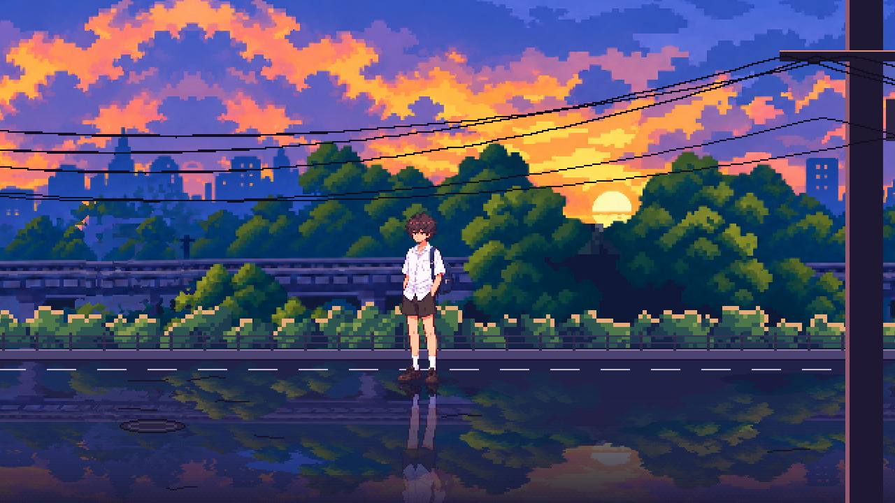
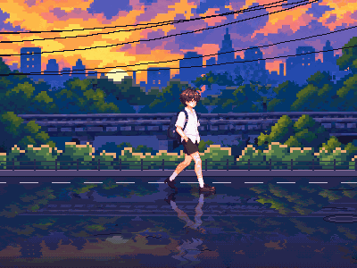
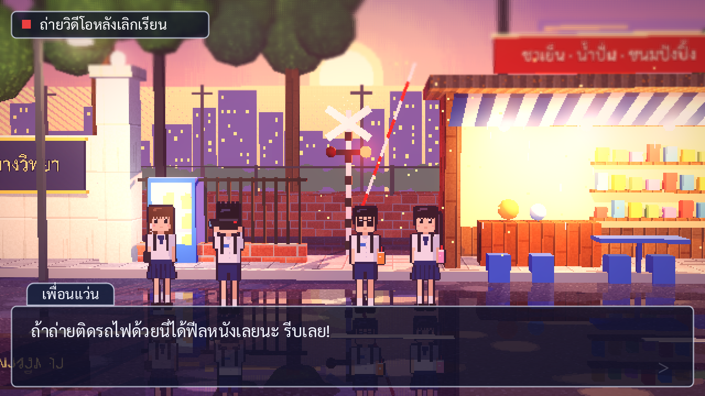

# Story-game

เกมเนื้อเรื่องแนว visual novel ภาพ pixel art สร้างด้วย **Godot 4.3** (GDScript, renderer: Compatibility)



## วิธีเปิดโปรเจกต์

1. ดาวน์โหลด [Godot 4.3+](https://godotengine.org/download) (ตัวธรรมดา ไม่ต้องใช้ .NET)
2. เปิด Godot → **Import** → เลือกไฟล์ `project.godot` ในโฟลเดอร์นี้
3. กด **F5** เพื่อรันเกม
   - คลิกซ้าย / Space / Enter = ข้อความถัดไป
   - ลูกศรซ้าย-ขวา หรือ A/D = เดิน (ฉากวนซ้ำไปเรื่อยๆ ไม่มีที่สิ้นสุด)
   - ขยับเมาส์ซ้าย-ขวา = กล้องโยก เห็นเอฟเฟกต์ parallax

## เล่นบนเว็บ/มือถือ

- บนจอสัมผัสจะมีปุ่ม ◀ ▶ (กดค้าง = เดิน) และแตะที่อื่นเพื่อไปข้อความถัดไป (`scripts/touch_controls.gd`)
- บนเว็บ/มือถือ ภาพขยายเต็มจอแบบไม่ต้องเป็นจำนวนเท่าเต็ม (ตั้งใน `main.gd`)
- export: `godot --headless --export-release "Web" build/web/index.html`
  (preset "Web" ใน `export_presets.cfg` ปิด thread ไว้ จึงวางบนโฮสต์ธรรมดาได้โดยไม่ต้องตั้ง header พิเศษ)

## โครงสร้าง

```
project.godot            ตั้งค่าโปรเจกต์ (640x360 ขยาย x2 แบบ integer, filter = Nearest)
scenes/main.tscn         ฉากหลัก: กล้อง + ชั้น Parallax2D + ตัวละคร + UI
scenes/main_3d.tscn       ฉาก HD-2D (3D ทำเป็น 2.5D)
scenes/dialogue_box.tscn กล่องข้อความ + ป้ายชื่อ
scripts/main.gd          โหลดบทจาก JSON และสั่งกล้อง/อีเวนต์
scripts/dialogue_box.gd  ข้อความพิมพ์ทีละตัว, คลิกเพื่อไปต่อ
scripts/scene_camera.gd  กล้องเลื่อนตามบทและโยกตามเมาส์
scripts/train.gd         รถไฟวิ่งผ่านฉาก
data/chapter1.json       บทพูด (แก้ตรงนี้เพื่อเขียนเนื้อเรื่อง)
assets/bg/               ภาพพื้นหลังแยกชั้น
assets/characters/       สไปรต์ตัวละคร
assets/fonts/            ฟอนต์ไทย Sarabun (SIL OFL)
tools/                   สคริปต์สร้างภาพ placeholder (พื้นหลัง, ตัวละคร, texture)
assets/textures/         texture พิกเซลสำหรับฉาก HD-2D
```

## ฉากหลัก: ทางรถไฟยามเย็น (ภาพจากผู้ใช้)

`scenes/main.tscn` ใช้ภาพท้องฟ้าและทางรถไฟใน `art_source/` ประกอบด้วย `tools/compose_sunset_scene.py`:
- ย่อภาพให้เข้ากับจอเกม 640×360 (กว้าง 800 เผื่อแพนกล้อง)
- ชั้นทางรถไฟใช้ภาพสะพานยาว `art_source/railway_long.png` ทำเป็นพิกเซลขนาด 2x2 (ย่อ 1/2 ลดสีแยกชุดต้นไม้/สะพาน วาดเส้นรางกลับ แล้วขยาย) วางรางที่ความสูงเดิม
  ต่อหัวท้ายโดยซ้อนปลายภาพทับต้นภาพ แล้วหาเส้นตัดที่สองฝั่งต่างกันน้อยที่สุด (ผ่านช่องว่าง/ตัวสะพาน/ใบไม้ที่คล้ายกัน) จึงมองไม่เห็นรอยต่อ
- ตึกในเมืองยังแยกมาจากภาพทางรถไฟเดิม (`railway.png`) เป็นชั้นไกล
- เติมแนวพุ่มไม้เงาเข้มไว้หลังชั้นทางรถไฟ (`railway_fill`) ไม่ให้เห็นท้องฟ้าใต้ต้นไม้
- วาดรถไฟฟ้าพิกเซล 4 ตู้ (พิกเซล 2x2) สีขาว/น้ำเงิน/เส้นแดง หน้ารถสีดำ (`make_train`) ล้อวางบนรางหน้าพอดี อยู่ในชั้นของตัวเอง (`TrainLayer`, ความเร็ว parallax เท่าทางรถไฟ ไม่วาดซ้ำ)
  วิ่งผ่านจอจากนอกจอซ้ายไปพ้นจอขวา (`across_screen` ใน `train.gd`)
- ตัวละครเดินบนทางเท้า (`sidewalk`, พิกเซล 2x2): แผ่นคอนกรีตเรียงสลับ 3 แถว (แถวไกลบีบเล็กกว่า ทางเท้าแคบเพราะมองจากด้านข้าง) มีรอยแตก คราบ มอสตามร่อง
  แผ่นที่ชื้นสีเข้มกว่า (ทึบทั้งหมด ไม่เห็นอะไรทะลุ) ขอบทางเท้าเป็นปูนเปลือยลงไปที่ถนน; เงาสะท้อนตัวละครจางและสั้นเพราะทางเท้าไม่ค่อยสะท้อน
- วาดถนนยางมะตอย (`road_surface`, พิกเซล 2x2) มีเม็ดหิน รอยปะ คราบน้ำมัน รอยล้อ รอยร้าว ความเปียกไล่ระดับแบบ dither จากแห้งไปแอ่งน้ำ (แอ่งลึกสุดยังเห็นยางมะตอยครึ่งหนึ่ง มีประกายระลอกน้ำ ไม่ใสเป็นกระจก), เงาท้องฟ้า+ทางรถไฟ, เงาสะท้อนรถไฟที่วิ่งตาม (`scripts/follow_x.gd`)
  และเงาสะท้อนตัวละครแบบกลับหัวมีระลอกน้ำ (`shaders/water_reflection.gdshader`)
- รั้วและแนวพุ่มไม้วาดที่ 1/3 ความละเอียดแล้วขยาย 3 เท่า ให้พิกเซลใหญ่เท่าภาพต้นฉบับ
- เสาไฟฟ้าคอนกรีตแบบไทยด้านหน้า (`build_foreground`, พิกเซล 2x2): เสาเรียว ขอบรับแสงเย็น คาน+ลูกถ้วย หม้อแปลงมีครีบ
  โคมไฟถนน ม้วนสาย กล่องต่อสาย ใบประกาศ ขั้นปีน สายไฟและสายสื่อสารหย่อนไปเสาต้นก่อน

**บรรยากาศของภาพ:** (สร้างใน `build_atmosphere()` ของ `compose_sunset_scene.py` ทุกชั้นตรงกับตำแหน่งดวงอาทิตย์ในภาพท้องฟ้า)
- แสงเรืองรอบดวงอาทิตย์ (`sun_glow`, บวกแสงแบบ additive) ทับยอดไม้ = แสงย้อน
- ลำแสงพาดลงจากดวงอาทิตย์ (`sun_rays` + `shaders/light_shafts.gdshader` ให้ลำแสงค่อยๆ หายใจ)
- หมอกยามเย็นตามระยะ: หนาที่เส้นขอบฟ้าหลังเมือง (`haze_far`) บางลงที่ยอดไม้ (`haze_near`) อุ่นใกล้ดวงอาทิตย์ ม่วงที่อื่น
- เมฆบางๆ ลอยช้าๆ (`wisps`, `Parallax2D.autoscroll`)
- ฝุ่นละอองลอยในแสง (`Dust`, CPUParticles2D ตามกล้อง)
- ปรับโทนทั้งจอ (`shaders/grade.gdshader`): เงาอมม่วง แสงอมชมพูส้ม (ไม่เหลือง) ขอบจอมืดลงนิด (UI ไม่โดน)

**บรรยากาศ (เสียงและสิ่งมีชีวิต):** เสียงทั้งหมดสังเคราะห์ด้วย `tools/make_audio.py` (ไม่ใช้ไฟล์อัด) ไว้ที่ `assets/audio/`
- `Ambience` เสียงยามเย็นวน 24 วินาทีแบบไร้รอยต่อ เฉพาะเสียงที่ไม่มีภาพ: เมืองอื้ออึง ลม จิ้งหรีด จักจั่น
- สิ่งที่เห็นบนจอส่งเสียงเองตอนอยู่บนจอเท่านั้น:
  - รถไฟ (ล้อกระทบรอยต่อราง เสียงมอเตอร์) เงียบตอนอยู่นอกจอ ค่อยๆ ดังเมื่อโผล่ ดังสุดกลางจอ (`sound` ใน `train.gd`)
  - ฝูงนกร้องเป็นระยะขณะบินอยู่บนจอ (`call_sound` ใน `birds.gd`, เสียงนก 3 แบบสุ่ม)
- เสียงเท้าบนถนนเปียก 3 แบบสุ่มระดับเสียง เล่นตอนเท้าแตะพื้น (`step_frames` ใน `hero_walker.gd`)
- ฝูงนก 3-7 ตัวบินผ่านท้องฟ้าเป็นระยะ (`scripts/birds.gd`, ชั้น parallax ไกล)
- บนเว็บ เบราว์เซอร์ไม่ให้เล่นเสียงก่อนผู้เล่นแตะ/คลิก จึงมีหน้า "แตะเพื่อเริ่ม" (`main.gd`) แตะแล้วเสียงบรรยากาศและบทเริ่มพร้อมกัน
  และเตรียมเสียงทุกไฟล์ไว้ล่วงหน้าตอนโหลดฉาก (`AudioServer.register_stream_as_sample`) เสียงแรกของรถไฟ/นก/เท้าจึงไม่ดีเลย์

**ฉากวนไม่สิ้นสุด (เดินไปเรื่อยๆ):**
- ทุกชั้นต่อหัวท้ายกันได้พอดี (seamless) แล้วใช้ `Parallax2D.repeat_size` ให้ Godot วาดซ้ำเอง
  - ทางรถไฟ 958px (ภาพสะพานยาวที่ต่อหัวท้ายด้วยเส้นตัดที่เนียนที่สุด)
  - ท้องฟ้า ต่อกับภาพกลับด้านของตัวเอง (1600px) จึงไม่มีรอยต่อ
  - พุ่มไม้ รั้ว (ห่าง 24px) เส้นประถนน (36px) สายไฟ (เสาละ 960px) ถูกสร้างให้วนรอบพอดี
- เงาสะท้อนแยกเป็นชั้นตามสิ่งที่มันสะท้อน (ท้องฟ้า/ทางรถไฟ) แล้วมีผิวถนนเปียกโปร่งแสงทับ
  เงาสะท้อนของที่อยู่ไกลจึงเลื่อนช้าตามจริง ส่วนถนนเลื่อนเท่าเท้าตัวละคร (ไม่ไถล)
- `scripts/hero_walker.gd` เดินด้วยลูกศร/A/D ยืนนิ่งใช้ภาพ idle เดินเล่นแผ่นภาพท่าเดิน 15 เฟรม (พลิกภาพตามทิศ) หยุดแล้วท่ายืนหันไปทางที่เดินล่าสุด



### ท่ายืนเคลื่อนไหว (ไม่ต้องใช้วิดีโอ)

```
python3 tools/make_idle_anim.py assets/characters/hero_uniform.png assets/characters/hero_idle.png
```

สร้าง 14 เฟรมจากภาพยืนภาพเดียวแบบพิกเซลล้วน (ไม่ยืด) 7 ท่า: ปกติ → ไหล่ลง 1px (หัวยังอยู่) → หัวตามลง (ปลายผมค้าง)
→ ลงสุด → ผมเด้งเกิน → ไหล่ขึ้นก่อน → หัวขึ้น (ผมค้าง) และทั้ง 7 ท่าแบบหลับตา แถวที่เพิ่ม/หายแต่ละจุด (คอ ผม เสื้อ) คือแถวที่เหมือนแถวข้างเคียงที่สุด
หน้าและคางจึงไม่เพี้ยน `hero_walker.gd` เล่นตาม `breath_steps` และกะพริบตาแบบสุ่มทุก 2-5 วินาที

### นำเข้าท่าเดินจากวิดีโอฉากเขียว

```
python3 tools/import_walk_video.py art_source/hero_walk_greenscreen.mp4 assets/characters/hero_walk.png \
    --start 20 --cycle 30 --height 122 --palette assets/characters/hero_uniform.png \
    --frames 15 --shoe-scale 0.8
```

วิดีโอต้องเป็นตัวละครเดินอยู่กับที่ (กล้องนิ่ง) สคริปต์ตัดหนึ่งรอบก้าว (`--cycle` เฟรม) เลือกมา `--frames` เฟรม
ลบพื้นเขียว แบ่งสีภาพยืน (`--palette`) เป็นกลุ่มวัสดุ (ผม ผิว เสื้อ กางเกง กระเป๋า ...)
ย่อภาพโดยแต่ละพิกเซลใช้วัสดุที่กินพื้นที่ส่วนใหญ่ของช่อง (ไม่เฉลี่ยสี ภาพจึงคม ไม่เบลอ)
แล้วให้เฉดในแต่ละวัสดุกระจายเหมือนภาพยืนพอดี (สีตรงกับภาพยืน) และวาดเส้นขอบ 1px ด้วยสีขอบของภาพยืน
ทุกเฟรมถูกจัดตำแหน่งตั้งแต่ในวิดีโอ (ปกเสื้อ/ลำตัวตรงกัน) ก่อนย่อ ช่วงบนจึงถูกตัดเป็นพิกเซลแบบเดียวกันทุกเฟรม (ไม่ยิบ)
แล้วยืด/หดช่วงขา (`--legs`, ชายกางเกงถึงข้อเท้า) ทีละเฟรมจนปกเสื้อสูงเท่าภาพยืนพอดี และยุบลง `--bob` (1px) เฉพาะตอนก้าวกว้าง
`--shoe-scale 0.8` ย่อรองเท้าแต่ละข้างลงเหลือ 80% ของความสูง (ทั้งก้อน รูปทรงไม่ขาด) ยึดที่ข้อเท้า แล้วเลื่อนภาพลงให้เท้าแตะพื้น
- ความเร็วเดิน 71 px/วินาที = เท้าที่วางบนพื้นในภาพเลื่อน ~5.9 px ต่อเฟรม x 12 เฟรม/วินาที (เท้าไม่ไถล)
- ฉากและตัวละครใช้ `shaders/smooth_pixel.gdshader` (sharp bilinear): คมแบบพิกเซล แต่วางที่เศษพิกเซลได้ ชั้นไกลที่เลื่อนช้า (ต้นไม้/ทางรถไฟ/เมือง) จึงไม่กระโดดทีละพิกเซล และพิกเซลกว้างเท่ากันบนจอมือถือที่ขยายไม่เป็นจำนวนเต็ม (ปิด `snap_2d_transforms_to_pixel`)
- กล้องทำงานหลังตัวละครในแต่ละเฟรม (`process_priority`) และไม่ปัดตำแหน่งเป็นพิกเซลเกม ฉากจึงเลื่อนลื่นไม่กระตุก กล้อง (`scene_camera.gd`) ล็อกตามตัวละคร (`follow`) และ `camera_x` ในบทกลายเป็นระยะเลื่อนกล้องออกจากตัวละคร

**ความเร็วแต่ละชั้น (parallax) ตามระยะจริง:** ตัวละครอยู่ห่างกล้อง ~4 ม. ชั้นที่อยู่ห่าง D เมตรจะเลื่อน ≈ 4/D

| ชั้น | ระยะ | scroll_scale |
|---|---|---|
| ท้องฟ้า (+เงาสะท้อน) | ไกลมาก | 0.01 |
| ตึกในเมือง (+เงาสะท้อน) แยกออกจากภาพทางรถไฟด้วยโทนสีน้ำเงิน แล้วต่อตึกลงไปหลังต้นไม้ | 1–2 กม. | 0.03 |
| ต้นไม้ สะพานรถไฟ รถไฟ (+เงาสะท้อน) | ~30 ม. | 0.12 |
| ถนน รั้ว พุ่มไม้ริมรั้ว | ~4 ม. | 1.0 |
| เสาไฟหน้ากล้อง | ~3 ม. | 1.25 |

**กด Tab สลับฉาก:** ทางรถไฟยามเย็น → ถนนอนิเมะ (`street_anime.tscn`) → HD-2D (`main_3d.tscn`)

## ฉาก 2D ถนนสไตล์อนิเมะ (วาดด้วยโค้ด)

`scenes/street_anime.tscn` พื้นหลังวาดด้วย `tools/make_anime_bg.py` (ไฟล์อยู่ใน `assets/bg/street/`):
ฉากถนนแบบมีมุมมอง (perspective) จุดลับตาอยู่ระดับสายตาตัวละคร, ย้อนแสงพระอาทิตย์ตก,
เสาไฟและสายไฟระโยงระยาง, ทางรถไฟพร้อมไม้กั้น, ตู้กดน้ำ, ร้านน้ำ, พื้นเปียกสะท้อนแสง
สคริปต์จัดวางทุกอย่างเป็นหน่วยเมตรแล้วฉายภาพด้วยกล้อง จึงแก้ตำแหน่ง/เพิ่มบ้านได้ในโค้ด

**เส้นขอบแบบอนิเมะ (line art):** ทุกชิ้นที่วาดจะได้ ID ของตัวเอง แล้วสคริปต์ลากเส้นขอบ 1px
ตรงรอยต่อระหว่างวัตถุกับสิ่งที่อยู่ข้างหลัง สีเส้นเป็นสีเข้มของวัตถุนั้นเอง (selective outline)
เส้นเข้มสุดในระยะใกล้และจางลงตามระยะ (`line_strength` ของแต่ละชั้น) ท้องฟ้าไม่มีเส้นเหมือนฉากหลังอนิเมะจริง

**เมฆและต้นไม้ (`tools/anime_shapes.py`):**
- เมฆคิวมูลัส: ก้อนกลมซ้อนเป็นหอคอยฐานแบน ลงแสงทั้งก้อนเป็นปริมาตรเดียว แล้วแบ่งเป็นโทนสีขั้นๆ แบบ cel shading
  ก้อนหน้าทับก้อนหลังเกิดรอยพับ ด้านที่หันหาพระอาทิตย์เป็นสีส้มชมพู ด้านเงาเป็นม่วงฟ้า
- ต้นไม้: ทรงพุ่มเป็นกลุ่มใบหลายกลุ่ม ขอบเป็นหยักมน (วงกลมเล็กรอบแกนกลาง) ลงแสง 5 โทน
  แตกโทนด้วย texture ใบไม้เฉียงๆ มีรอยพับเข้มระหว่างกลุ่มใบ ขอบรับแสงอุ่น กิ่งโผล่ตามช่อง

### นำเข้าตัวละครจากภาพฉากเขียว

```
python3 tools/import_sprite.py art_source/hero_uniform_greenscreen.png assets/characters/hero_uniform.png
```

สคริปต์หาขนาด "พิกเซลจริง" ของภาพที่ถูกขยายมา (เช่นภาพจาก AI ขนาด 1254px) ย่อกลับเป็นพิกเซลอาร์ตจริง
ลบพื้นเขียวและขอบเขียว แล้วตัดขอบว่าง ภาพต้นฉบับเก็บไว้ใน `art_source/`

## ชั้น Parallax (จากไกล → ใกล้)

| ชั้น | ไฟล์ | ระยะ | scroll_scale |
|---|---|---|---|
| ท้องฟ้า พระอาทิตย์ เมฆ | `01_sky.png` | ไกลมาก | 0.03 |
| ภูเขา เมือง ปลายถนน | `02_city_far.png` | 60 ม.+ | 0.1 |
| บ้านสองข้างทาง เสาไฟ | `03_street.png` | 18–60 ม. | 0.2 |
| รถไฟ | `03_train.png` | 17 ม. | 0.28 |
| ทางรถไฟ ไม้กั้น โรงเรียน ร้านน้ำ | `04_mid.png` | 7–18 ม. | 0.45 |
| ถนนเปียกใกล้ตัว | `05_ground.png` | 2–7 ม. | 0.6 |
| ตัวละคร | `assets/characters/` | 4 ม. | 1.0 |
| เสาไฟ สายไฟ ใบไม้ หน้ากล้อง | `06_foreground.png` | 2–3 ม. | 1.25 |

`scroll_scale` น้อย = อยู่ไกล เลื่อนช้า, มากกว่า 1 = อยู่หน้ากล้อง เลื่อนเร็วกว่าตัวละคร

ภาพสร้างด้วยสคริปต์ (แทนที่ด้วยงานวาดจริงได้โดยใช้ชื่อไฟล์เดิม):
`tools/make_anime_bg.py` (พื้นหลังฉาก 2D), `tools/make_placeholder_art.py` (ท้องฟ้า/เมืองของฉาก HD-2D ใน `assets/bg/hd2d/`),
`tools/make_characters.py` (ตัวละคร 32×72 ของฉาก HD-2D), `tools/make_textures.py` (texture ฉาก 3D)
เปลี่ยนเป็นภาพจริงได้เลย (เช่น วาดใน Aseprite แล้ว export ทีละเลเยอร์) โดยใช้ชื่อไฟล์เดิม
ภาพพื้นหลังกว้าง 800px สูง 360px (กว้างกว่าจอ 640px เพื่อให้กล้องเลื่อนได้)

## ฉาก HD-2D (3D ทำเป็น 2.5D)



`scenes/main_3d.tscn` คือฉากเดียวกันที่สร้างเป็น 3D ใช้บท กล่องข้อความ และสไปรต์ตัวละครชุดเดิม
**กด Tab ระหว่างเล่นเพื่อสลับระหว่างฉาก 2D กับ HD-2D** (หรือเปิด `main_3d.tscn` แล้วกด F6)

- `scripts/hd2d_set.gd` สร้างฉากจากกล่อง 3D ที่ปู texture พิกเซล (ประตูโรงเรียน ไม้กั้นรถไฟ ร้านน้ำ ตู้กดน้ำ เสาไฟ สายไฟ ต้นไม้) และนำภาพท้องฟ้า/เมืองเดิมมาวางเป็นแผ่นไกลๆ
- ป้ายภาษาไทยเป็น `Label3D` (ชื่อโรงเรียน, ป้ายร้าน) แก้ข้อความได้ในสคริปต์
- ฝุ่นละอองเรืองแสงในแสงไฟร้าน + หยดน้ำจากกันสาด (`CPUParticles3D`)
  เป็น `@tool` จึงเห็นฉากในหน้าต่าง editor ด้วย เมื่อมีโมเดลจริงจาก Blender ให้วางแทนกล่องได้เลย
- แสงจริง: พระอาทิตย์ย้อนแสง หลอดไฟร้าน ไฟไม้กั้นกะพริบ + glow และหมอก (`WorldEnvironment`)
- พื้นเปียก: พื้นโปร่งแสง + ฉากกลับหัวข้างใต้ = เงาสะท้อน, แอ่งน้ำสะท้อนชัดกว่า (ปรับได้ที่ `wetness`)
- ตัวละครเป็น `Sprite3D` แบบ billboard ที่รับแสงและมีเงา
- `shaders/hd2d_post.gdshader` เบลอขอบบน-ล่าง (tilt-shift) + ปรับสีโทนอุ่น + vignette
- 3D เรนเดอร์ที่ 640×360 ใน `SubViewport` แล้วขยายแบบ Nearest ทุกอย่างจึงเป็นพิกเซล
- ใช้ renderer **Compatibility** เล่นบนเว็บและเครื่องสเปกต่ำได้
  ถ้าเปลี่ยนเป็น Forward+ จะใช้ SSR (สะท้อนจริง), depth of field และ volumetric fog ได้ แต่เกมจะหนักขึ้น

## เขียนบท

แก้ไฟล์ `data/chapter1.json`:

```json
{ "speaker": "เพื่อนสาว", "text": "จะยืนเหม่ออีกนานไหม", "camera_x": 270, "event": "train" }
```

- `speaker` ชื่อผู้พูด (เว้นว่าง = คำบรรยาย ไม่แสดงป้ายชื่อ)
- `text` ข้อความ (รองรับ BBCode เช่น `[color=yellow]คำ[/color]`)
- `camera_x` (ไม่ใส่ก็ได้) เลื่อนกล้องไปตำแหน่ง x (260–380)
- `event` (ไม่ใส่ก็ได้) ตอนนี้มี `"train"` = รถไฟวิ่งผ่าน
