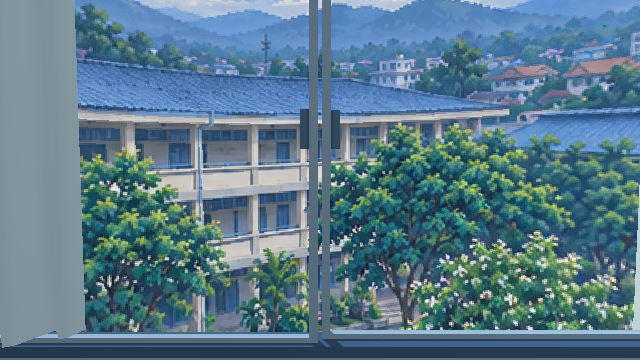
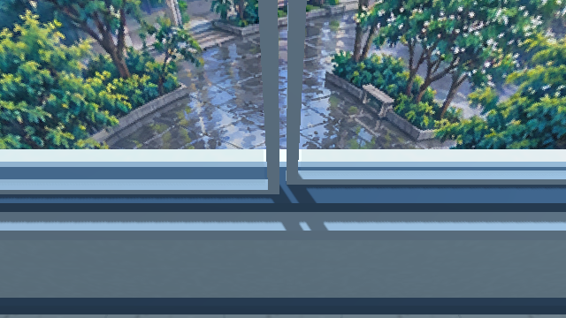
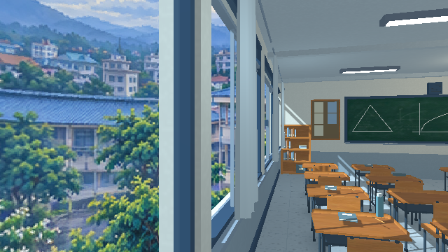

# ห้องเรียนไทย 3D Pixel — Godot 4.3

ฉากทดลองห้องเรียน 3D พร้อมภาพวาดบนวัสดุ และวิวพิกเซลรอบทิศนอกหน้าต่าง แยกจากบทและฉากเริ่มเกม

งานรอบทดสอบเก็บใน GitHub และ PR นี้ ใช้ Godot เรนเดอร์ภาพและแพ็กโปรเจกต์เป็น artifact โดยไม่เผยแพร่ Site อัตโนมัติ

## เปิดและควบคุม

- เปิด `scenes/classroom_3d_pixel.tscn` ใน Story-game แล้วกด F6
- หรือดาวน์โหลด ZIP จาก Actions เปิด `project.godot` ด้วย Godot **4.3** แล้วกด F5
- ปุ่ม 1–4 เลือกมุมหลังห้อง มุมเฉียง หน้าห้อง และนอกหน้าต่าง
- WASD เลื่อนกล้อง, Q/E ปรับความสูง, เมาส์ขวาค้างแล้วลากหรือใช้นิ้วลากเพื่อหันกล้อง
- P สลับ 640×360 (เริ่มต้น), 480×270 และ 960×540; H ซ่อนแถบควบคุม; F12 บันทึกภาพ

## ฉบับล่าสุด

- ชั้นหนังสือไม้แบบเปิด มีหนังสือและช่องเก็บของ
- หน้าต่างบานเลื่อนและทางระเบียงที่มีความลึกจริง
- นาฬิกาอยู่ข้างกระดานโดยไม่ทับขอบ
- ใบพัดทั้งสองตัวหมุนแยกจากก้านที่ยึดกับเพดาน
- ไม้ กระดานและบอร์ดใช้ภาพวาดร่วมกับรูปทรง 3D
- วิวลานด้านในโรงเรียนเป็นภาพวาดพิกเซลรอบทิศ ครอบคลุมตอนหันซ้าย ขวา ก้ม และเงย ไม่มีขอบแผ่นภาพให้มองทะลุไป
- MultiMesh รวมชิ้นส่วนคงที่: 1,147 ชิ้น / 211 render instances และป้ายเดิม ใบพัดยังเป็นโหนดเคลื่อนไหว

## ทดสอบใน GitHub

Workflow **Godot 4.3 classroom cloud preview** ทำงานเมื่อ PR แก้ไฟล์ห้องเรียน หรือกด Run workflow เองในสาขานี้

1. แพ็กโปรเจกต์ห้องเรียนแยกจากเกมหลัก
2. Import และสร้างฉากด้วย Godot 4.3 แล้วตรวจกล้อง การหมุนพัดลม MultiMesh และพื้นหลังรอบทิศ
3. เรนเดอร์ 4 มุมกล้อง และ 13 ภาพตรวจขอบเขตวิวผ่านหน้าต่าง
4. แนบ PNG และ ZIP ของโปรเจกต์ที่ทดสอบแล้วใน artifact `classroom-godot43-preview`

ไม่เปลี่ยน workflow GitHub Pages ของเกมหลัก และไม่ merge PR อัตโนมัติ

## ทดสอบในเครื่อง

```sh
python3 tools/package_classroom.py --output build/classroom-preview
project="$PWD/build/classroom-preview/Thai-Classroom-Godot43"
godot --headless --editor --path "$project" --import --quit
godot --headless --path "$project" --script res://tools/build_classroom_scene.gd
godot --headless --path "$project" --script res://tools/test_camera_input.gd
godot --headless --path "$project" --script res://tools/test_web_scene.gd
CAMPUS_REVIEW_OUT="$PWD/build/classroom-preview/coverage" xvfb-run -a godot --path "$project" --rendering-method gl_compatibility --audio-driver Dummy --script res://tools/review_window_coverage.gd
python3 tools/package_classroom.py --output build/classroom-preview --zip-only
```

การสร้างฉากใหม่เขียนทับฉากที่บันทึกไว้ จึงควรสำรองการแก้โมเดลด้วยเอดิเตอร์ก่อนรันตัวสร้าง

## ภาพจาก Godot





ภาพเหล่านี้เป็นภาพเรนเดอร์จริงใน Godot ไม่ใช่ภาพจำลองหน้าจอ วิวภายนอกใช้ภาพวาดบนทรงกลมที่ระยะอนันต์ จึงไม่มี parallax แยกต้นไม้กับอาคารเมื่อเลื่อนกล้อง ข้อจำกัดนี้ต่างจากรูปทรง 3D ของห้องที่ขยับมุมมองได้จริง

ยังไม่ได้วัดประสิทธิภาพบนโทรศัพท์จริง รายละเอียดภาพต้นทางและขอบเขตการตรวจเดิมอยู่ใน [บันทึกการต่อวิว](courtyard-surround-review.md)

## นักเรียนนั่งในห้อง

ดู [ผังที่นั่งและภาพนักเรียน](seated-students.md): สายฝนที่ 25 ซ้ายสุดหลังสุด ซันที่ 19 ด้านหน้าหนึ่งโต๊ะ และตัวประกอบบนเก้าอี้อื่นครบ 30 คน
