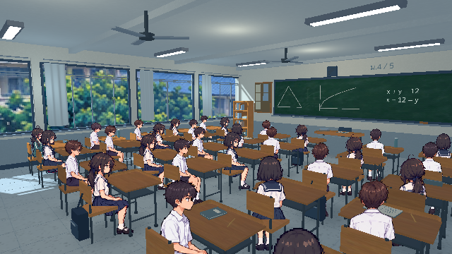
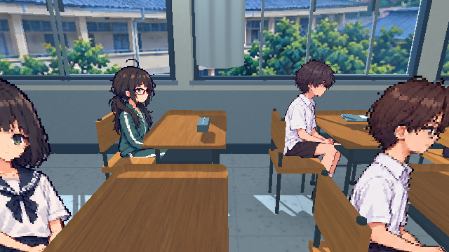
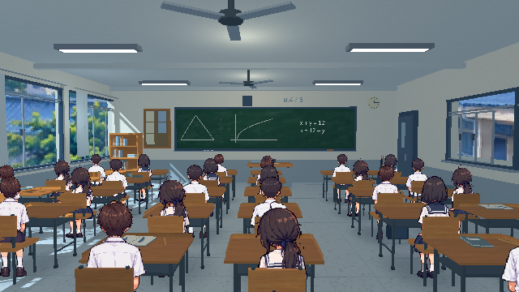
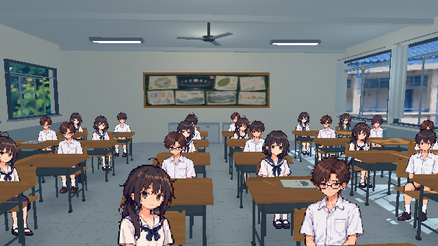

# นักเรียนในห้องเรียน

นักเรียน 30 คนบนเก้าอี้เดิมของฉาก `classroom_3d_pixel.tscn` ซ้าย/ขวานับตอนหันหน้าเข้ากระดาน แถว 1 อยู่หน้าห้อง แถว 5 อยู่หลังห้อง

| แถว | ซ้ายสุดติดหน้าต่าง | 2 | 3 | 4 | 5 | 6 |
| --- | --- | --- | --- | --- | --- | --- |
| 1 — หน้าห้อง | 01 ชายผมสั้น | 02 หญิงผมบ๊อบ | 03 ชายแว่น | 04 หญิงหางม้า | 05 ชายผมสั้น | 06 หญิงผมบ๊อบ |
| 2 | 07 หญิงหางม้า | 08 ชายผมสั้น | 09 หญิงผมบ๊อบ | 10 ชายแว่น | 11 หญิงหางม้า | 12 ชายผมสั้น |
| 3 | 13 ชายแว่น | 14 หญิงหางม้า | 15 ชายผมสั้น | 16 หญิงผมบ๊อบ | 17 ชายแว่น | 18 หญิงหางม้า |
| 4 | **19 ซัน** | 20 ชายแว่น | 21 หญิงหางม้า | 22 ชายผมสั้น | 23 หญิงผมบ๊อบ | 24 ชายแว่น |
| 5 — หลังห้อง | **25 สายฝน** | 26 หญิงผมบ๊อบ | 27 ชายแว่น | 28 หญิงหางม้า | 29 ชายผมสั้น | 30 หญิงผมบ๊อบ |

สายฝนอยู่ซ้ายสุดหลังสุด ซันอยู่คอลัมน์เดียวกันหนึ่งโต๊ะด้านหน้า ภาพใหม่อ้างอิง `hero2_uniform_greenscreen.png` และ `heroine_greenscreen.png` เก็บผม เครื่องแต่งกาย และแว่นของตัวละครหลักตามต้นฉบับ

## ภาพและการแสดงผล

- สร้างภาพด้วย imagegen: 6 แบบ แต่ละแบบมีหน้า หลัง ซ้าย ขวา บนพื้นโปร่งใส ตัวประกอบ 4 แบบสลับที่นั่ง
- ไฟล์พร้อมใช้ `assets/classroom/students/*.png` แถวละ 4 เฟรม เฟรมละ 160×192 px ใช้ nearest filtering
- ตัวละครอยู่บนตำแหน่งเก้าอี้จริง รวมถึงเก้าอี้ที่เลื่อนออกและหมุนเล็กน้อย ไม่วาดโต๊ะ/เก้าอี้ซ้ำในภาพนักเรียน
- เลือกภาพจากตำแหน่งกล้องในโลก รักษาทิศหันหน้าสู่กระดาน มีระยะเผื่อที่รอยต่อมุมเพื่อกันภาพสลับถี่ โต๊ะกับพนักเก้าอี้บังร่างกายด้วย depth test
- ตัวประกอบผมบ๊อบใช้การพลิกภาพด้านข้างที่ runtime สำหรับทิศซ้าย
- เป็นภาพนั่งนิ่ง 2D ในฉาก 3D ไม่ใช่โมเดลนักเรียนรอบตัวหรือแอนิเมชัน

## ตรวจและดูภาพ

เปิดฉากเดิมแล้วกด F6 ปุ่ม 1–4 และการลากกล้องทำงานเหมือนเดิม งานนี้อยู่ในฉากห้องเรียนทดลอง ไม่ได้เพิ่มบทสนทนาหรือเชื่อมต่อบทหลัก

GitHub Actions `Godot 4.3 classroom cloud preview` ตรวจตำแหน่ง 30 ที่นั่ง ทิศภาพ 4 ด้าน และเก็บภาพห้องจากหน้า/หลัง/ด้านข้างในโฟลเดอร์ `students` ของ artifact `classroom-godot43-preview` พร้อม ZIP โปรเจกต์ ไม่มีการเผยแพร่ Site

## ภาพจากฉากจริง

ภาพและข้อจำกัดการตรวจ: [students-review.md](students-review.md)
