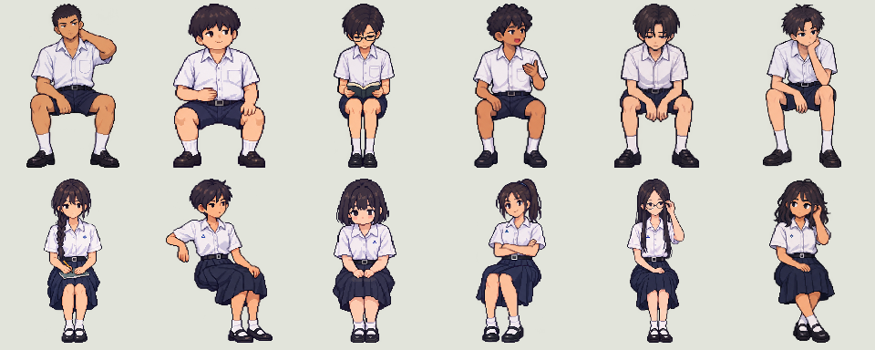

# นักเรียนในห้องเรียน — ฉบับปรับบุคลิกและชุดไทย ม.ปลาย

นักเรียน 30 คนบนเก้าอี้เดิม ซ้าย/ขวานับขณะหันหน้าเข้ากระดาน แถว 1 อยู่หน้าห้อง แถว 5 อยู่หลังห้อง

| แถว | ซ้ายสุดติดหน้าต่าง | 2 | 3 | 4 | 5 | 6 |
| --- | --- | --- | --- | --- | --- | --- |
| 1 — หน้า | ชายผมเกรียน | หญิงเปีย | ชายอ่านหนังสือ | หญิงผมสั้น | ชายผมหยิก | หญิงผมหยักศก |
| 2 | หญิงบ๊อบรูปร่างอวบ | ชายรูปร่างท้วม | หญิงหางม้า | ชายง่วง | หญิงแว่น | ชายเหม่อ |
| 3 | ชายผมหยิก | หญิงแว่น | ชายผมเกรียน | หญิงบ๊อบรูปร่างอวบ | ชายอ่านหนังสือ | หญิงหางม้า |
| 4 | **19 ซัน** | หญิงผมสั้น | ชายรูปร่างท้วม | หญิงผมหยักศก | ชายเหม่อ | หญิงเปีย |
| 5 — หลัง | **25 สายฝน** | ชายง่วง | ชายผมเกรียน | หญิงเปีย | ชายรูปร่างท้วม | หญิงแว่น |

ซันและสายฝนคงรูปและชุดเดิม ตัวประกอบสร้างใหม่ 12 แบบ ชาย 6 หญิง 6 ใช้แต่ละแบบ 2–3 ที่นั่ง สลับตำแหน่งเพื่อลดความรู้สึกเป็นกลุ่มคนซ้ำ

## บุคลิกและท่านั่ง

| แบบ | รูปร่าง/ผม | ท่าหลัก |
| --- | --- | --- |
| ชายผมเกรียน | ไหล่กว้าง ผิวแทน ผมเกรียน | เอนหลัง ยกมือแตะท้ายทอย |
| ชายรูปร่างท้วม | ตัวกว้าง แก้มกลม ผมทรงกะลา | นั่งสบาย มือหนึ่งบนท้อง |
| ชายอ่านหนังสือ | ผอมสูง ผมแสกข้าง แว่นเล็ก | ก้มอ่านหนังสือบนตัก |
| ชายผมหยิก | ผมหยิกสั้น ผิวเข้ม | เอียงคุยกับเพื่อน ยกมือเล็กน้อย |
| ชายง่วง | ไหล่แคบ ผมแสกกลาง | หลังงอ ศอกบนต้นขา มือปล่อย |
| ชายเหม่อ | หน้าผากสูง ผมปัดขึ้น | เอนข้าง เท้าคาง |
| หญิงเปีย | เปียเดี่ยว หน้ารูปไข่ | หลังตรง ถือสมุดและดินสอ |
| หญิงผมสั้น | ผมสั้นเปิดหู ผิวแทน | นั่งเอียง ศอกพาดพนัก |
| หญิงบ๊อบรูปร่างอวบ | แก้มกลม ผมบ๊อบหน้าม้า | ไหล่ห่อ กุมมือบนตัก |
| หญิงหางม้า | รูปร่างแข็งแรง หางม้าสูง | เอนหลัง กอดอกหลวม ๆ |
| หญิงแว่น | ผอมสูง ผมยาวแสกกลาง | หลังตรง มือจับขาแว่น |
| หญิงผมหยักศก | ผมหนาประบ่า ผิวเข้ม | เอนข้าง มือเก็บผมทัดหู |

## เครื่องแต่งกาย

นักเรียนหญิงตัวประกอบใช้ชุดไทย ม.ปลาย: เสื้อขาวแขนสั้นปกเชิ้ตสอดในกระโปรงจีบสีเข้มยาวคลุมเข่า มีเข็มขัดสีดำ ถุงเท้าขาวและรองเท้านักเรียนดำ ไม่มีปกกะลาสี ผ้าปกสีน้ำเงินหรือโบว์คอแบบญี่ปุ่น

## ไฟล์และภาพตรวจ

ภาพพร้อมใช้ `assets/classroom/students/*.png` เฟรมละ 160×192 px สี่ทิศ คงตำแหน่งบนเก้าอี้และ depth test ของโต๊ะ/พนักเก้าอี้เดิม เป็นภาพนั่งนิ่ง 2D ในฉาก 3D

- [พรอมป์ต์ฉบับใหม่](student-v2-prompts.json)
- [บันทึกตรวจภาพจริง](students-review.md)

GitHub Actions ตรวจและเก็บภาพใน artifact `classroom-godot43-preview` พร้อม ZIP โปรเจกต์ ฉากห้องเรียนยังเปิดแยกด้วย F6 ไม่มีการเผยแพร่ Site ใน PR นี้
