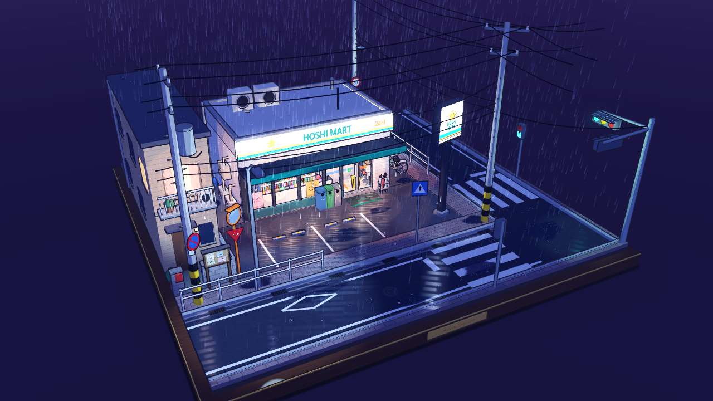
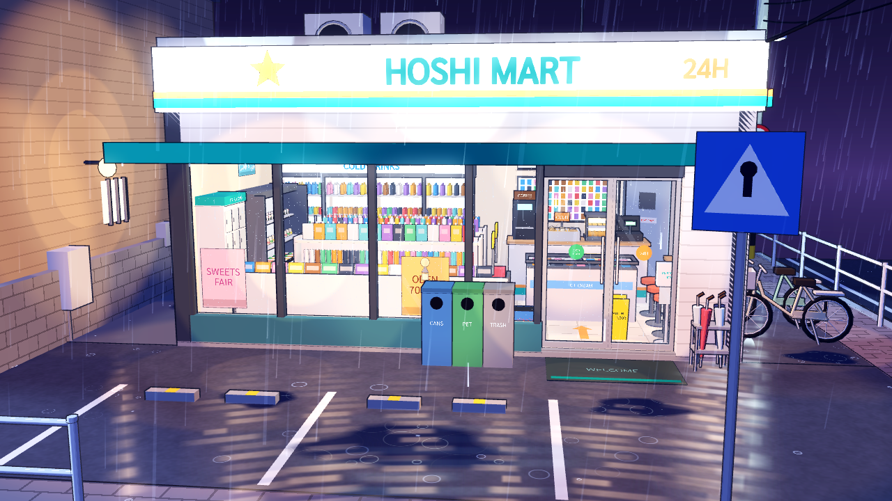
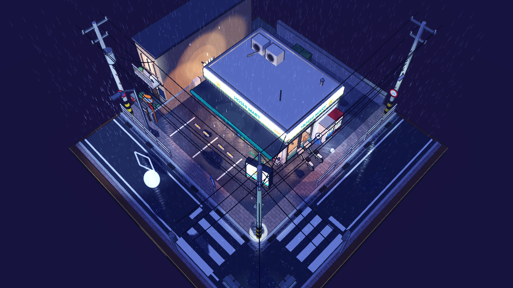
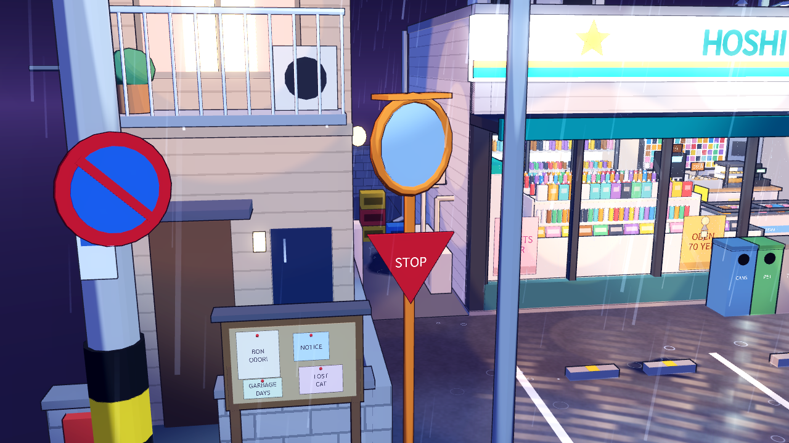
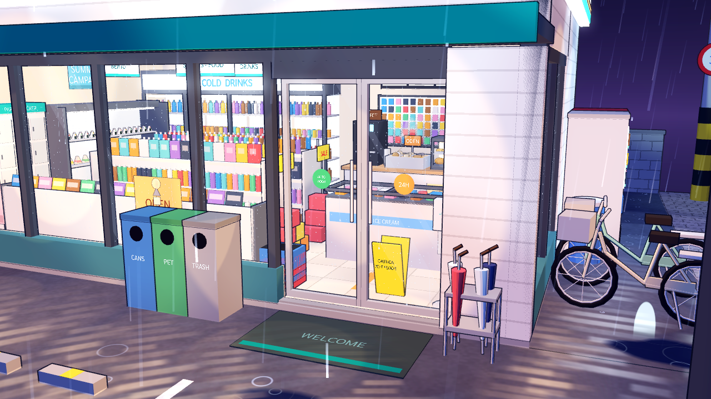
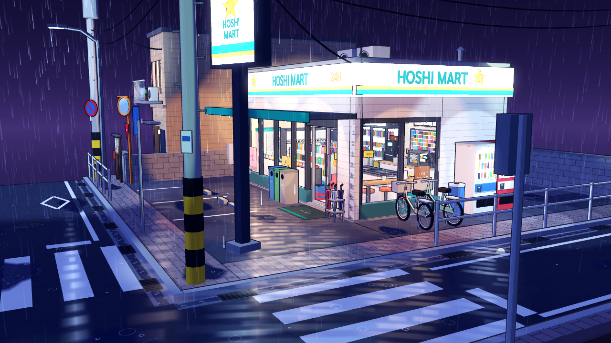

# ร้านสะดวกซื้อหัวมุมถนน คืนฝนตก — Diorama 3D แบบ Cel-shaded (Godot 4.3)

โมเดลจำลองขนาดเล็กของร้านสะดวกซื้อสไตล์ญี่ปุ่น "HOSHI MART" ที่หัวมุมถนนในย่านที่อยู่อาศัย ยามค่ำคืนที่ฝนตก
วางอยู่บนฐานไม้สี่เหลี่ยมจัตุรัสเหมือนโมเดลสะสม เรนเดอร์แบบ "3D ที่ดูเหมือน 2D" (cel-shaded) มีเส้นขอบ แสงเป็นขั้น และแสงสะท้อนบนพื้นเปียกแบบภาพวาดอนิเมะ
ไม่มีตัวละครและไม่มี UI บนจอ เป็นฉากแยกจากบทและฉากเริ่มเกม



## เปิดและควบคุม

- เปิด `scenes/konbini_diorama.tscn` ใน Story-game แล้วกด F6
- หรือดาวน์โหลด ZIP จาก Actions (workflow **Godot 4.3 konbini diorama preview**) เปิด `project.godot` ด้วย Godot **4.3** แล้วกด F5

ไม่มีปุ่มบนจอ ควบคุมด้วยการลากโดยตรง:

| | เมาส์ | สัมผัส | คีย์บอร์ด |
|---|---|---|---|
| หมุนรอบโมเดล | ลากปุ่มซ้าย | ลากนิ้วเดียว | ลูกศร |
| เลื่อน | ลากปุ่มขวา/กลาง หรือ Shift + ลากซ้าย | ลากสองนิ้ว | WASD |
| ซูม | ล้อเมาส์ / ทัชแพด | บีบสองนิ้ว | Q/E หรือ +/- |
| กลับมุมเริ่มต้น | | | R |

กล้องเคลื่อนแบบนุ่มนวล หยุดที่ขอบ: ไม่ลงใต้ฐาน ไม่ซูมทะลุ และเลื่อนได้ไม่เกินขอบฐาน

## ในฉากมีอะไรบ้าง

**ภายนอก** ป้ายร้านเรืองแสงด้านหน้าและด้านข้าง ป้ายเสาสูง กระจกบานใหญ่ ประตูอัตโนมัติ กันสาด พรมเช็ดเท้า
ถังขยะแยกประเภท ที่เสียบร่ม (มีร่มใส) ตู้กดเครื่องดื่ม 2 ตู้ จักรยานแม่บ้าน 2 คัน เสาไฟถนน เสาไฟฟ้า 3 ต้นพร้อมหม้อแปลงและสายไฟระโยงระยาง
ป้ายจราจร (ทางม้าลาย จำกัดความเร็ว 30 ห้ามจอด STOP) ราวกั้นสีขาว ช่องจอดรถพร้อมแท่งกั้นล้อ รางระบายน้ำพร้อมฝาตะแกรง ฝาท่อ
แอ่งน้ำ ทางม้าลาย 2 จุด เครื่องหมายข้าวหลามตัด ตรอกข้างร้าน คอมเพรสเซอร์แอร์ 3 ตัว ลังขวด กระจกโค้งที่ปากซอย
บอร์ดประกาศชุมชน บ้านข้างเคียงที่เปิดไฟชั้นบน ระเบียง กำแพงบล็อก และสัญญาณไฟจราจรที่มุมไกล

**ภายในร้าน** (มองผ่านกระจก) ตู้แช่เครื่องดื่ม 4 บาน ชั้นเบนโตะ แซนด์วิชและโอนิกิริ ชั้นสินค้า 2 แถว (ขนม บะหมี่ถ้วย กล่อง ของใช้)
เคาน์เตอร์พร้อมเครื่องชงกาแฟ หม้อโอเด้ง ตู้อุ่นของทอด และเครื่องคิดเงิน ผนังบุหรี่และเมนูเรืองแสง ชั้นนิตยสารริมกระจก
ตู้แช่ไอศกรีม ตู้ล็อกเกอร์รับพัสดุ เคาน์เตอร์นั่งกินริมกระจก (มีกาแฟที่ลืมไว้และร่มพิงอยู่) ตะกร้า ที่ใส่ถุงร่ม ป้ายระวังพื้นลื่น
สติกเกอร์รอคิวบนพื้น ป้ายแขวนบอกโซน โปสเตอร์ และประตู STAFF ONLY ที่แง้มไปห้องเก็บของ

**การเคลื่อนไหว** ฝนตกต่อเนื่อง (หลบใต้หลังคาและกันสาด สว่างขึ้นเมื่อผ่านแสงไฟ) ระลอกน้ำกระทบพื้น หลังคา และกันสาด
หยดน้ำจากชายคา ระเบียง ตู้กด และป้าย น้ำไหลจากท่อรางน้ำ วงน้ำในแอ่ง น้ำไหลในรางระบายน้ำ หยดน้ำไหลเป็นทางบนกระจก
ป้ายร้านเรืองแสงสั่นเบาๆ และป้ายเสากะพริบเป็นระยะ ประตูอัตโนมัติเปิดปิดทุก 9 วินาที ไอน้ำจากโอเด้งและกาแฟ
สัญญาณไฟจราจรเปลี่ยน เขียว-เหลือง-แดง แบบค่อยๆ เปลี่ยน พร้อมไฟคนข้ามที่กะพริบก่อนเปลี่ยน และแสงสะท้อนบนถนนเปียกที่หันตามมุมกล้อง

## วิธีสร้าง

ฉากสร้างจากโค้ดตอนโหลด ไม่มีไฟล์โมเดลหรือเท็กซ์เจอร์ภายนอก (ใช้แค่ฟอนต์ Sarabun สำหรับตัวหนังสือ)

| ไฟล์ | หน้าที่ |
|---|---|
| `scripts/konbini_kit.gd` | รวมรูปทรงพื้นฐานเป็นเมช สีอยู่ในจุดยอด ข้อมูลเส้นขอบใน CUSTOM0 รวม 3,277 ชิ้นเหลือ 83 mesh instances |
| `scripts/konbini_exterior.gd` | ฐาน ถนน ตัวร้าน และของข้างถนน |
| `scripts/konbini_interior.gd` | ภายในร้าน (render layer 2 รับเฉพาะแสงในร้าน) |
| `scripts/konbini_weather.gd` | ฝน ระลอกน้ำ หยดน้ำ แอ่งน้ำ รางน้ำ แสงสะท้อน |
| `scripts/konbini_camera.gd` | กล้องหมุนรอบ เมาส์ สัมผัส คีย์บอร์ด |
| `scripts/konbini_diorama.gd` | แสง บรรยากาศ ประตู ป้าย สัญญาณไฟ มุมกล้องตั้งต้น |
| `shaders/konbini_toon.gdshader` | แสงเป็นขั้น ไฮไลต์ขอบคมบนพื้นเปียก ลายพื้นทางเท้า กระเบื้อง ยางมะตอย ไม้ บล็อก |
| `shaders/konbini_outline.gdshader` | เส้นขอบแบบ inverted hull ความหนาคงที่บนจอ สีเส้นอิงสีวัตถุ |
| `shaders/konbini_reflection.gdshader` | แสงสะท้อนบนพื้นเปียก สว่างสุดที่ตำแหน่งภาพสะท้อนจริงของไฟ แตกเป็นเส้นตามระลอกน้ำ |
| `shaders/konbini_glass.gdshader` | กระจกใส แถบเงาสะท้อน หยดน้ำเกาะและไหลเป็นทาง |
| `shaders/konbini_rain/splash/drip/puddle/steam/sky.gdshader` | ฝน วงน้ำ หยดน้ำ แอ่งน้ำ ไอน้ำ ท้องฟ้า |

## ภาพจาก Godot

ภาพเรนเดอร์จริงจาก Godot 4.3 (Compatibility, ซอฟต์แวร์เรนเดอร์ใน xvfb) ขนาด 1280×720







## ทดสอบใน GitHub

Workflow **Godot 4.3 konbini diorama preview** ทำงานเมื่อ PR แก้ไฟล์ของฉากนี้ หรือกด Run workflow เอง

1. แพ็กฉากเป็นโปรเจกต์แยก (`tools/package_konbini.py`)
2. Import และรัน `tools/test_konbini_diorama.gd`: ไม่มีโหนด UI, กล้องหมุน ซูม เลื่อน และสัมผัสทำงานในขอบเขต, ประตูเปิด, ไฟจราจรเปลี่ยน
3. เรนเดอร์ 6 มุมกล้อง แล้วแนบ PNG และ ZIP ของโปรเจกต์ที่ทดสอบแล้วใน artifact `konbini-diorama-godot43`

## ทดสอบในเครื่อง

```sh
python3 tools/package_konbini.py --output build/konbini
project="$PWD/build/konbini/Konbini-Diorama-Godot43"
godot --headless --editor --path "$project" --import --quit
xvfb-run -a godot --path "$project" --rendering-method gl_compatibility --audio-driver Dummy --script res://tools/test_konbini_diorama.gd
xvfb-run -a godot --path "$project" --rendering-method gl_compatibility --audio-driver Dummy -- --view=0 --capture "$PWD/build/konbini/view-1.png"
```

`--view=0..5` เลือกมุมกล้อง `--capture PATH` บันทึกภาพแล้วปิด `--wait=SECONDS` รอก่อนบันทึก

## ข้อจำกัด

- ตัวหนังสือในฉากเป็นอักษรละติน (ฟอนต์ในโปรเจกต์ไม่มีอักษรญี่ปุ่น)
- แสงสะท้อนบนพื้นเป็นแบบวาด ไม่ใช่กระจกสะท้อนจริง จึงไม่สะท้อนรูปทรงของอาคาร
- ฝนตกเฉพาะเหนือฐาน เหมือนโมเดลในกล่อง
- ยังไม่ได้วัดประสิทธิภาพบนโทรศัพท์จริง และไม่ได้ export เป็นเว็บ
