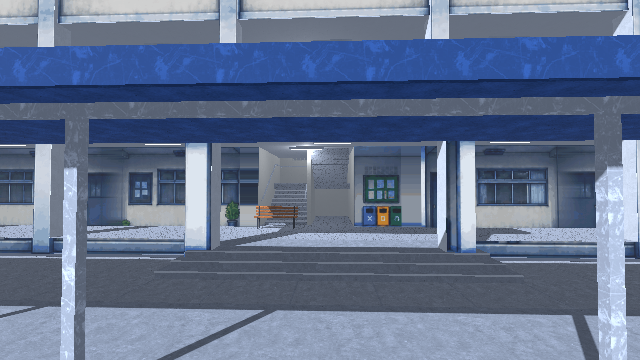
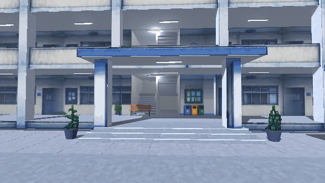
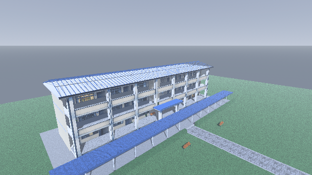
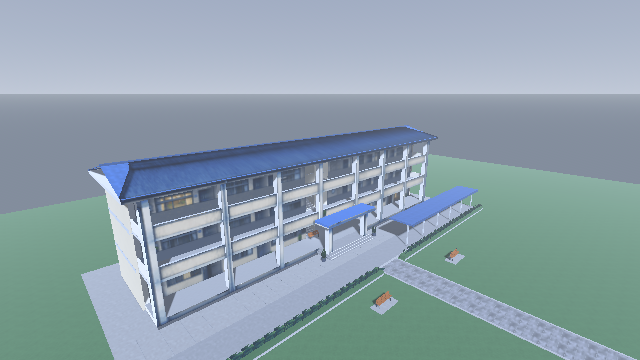
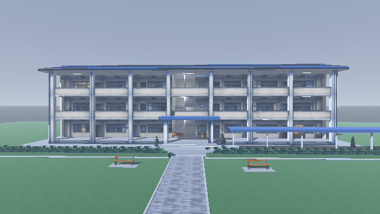

# School building visual revision — PR12

Latest clarity follow-up: [painted building clarity](clarity-review.md).

Latest follow-up: [repair the artwork behind pillars and parapets](wall-repair.md). The building/grounds review below records the preceding revision `9f81266`.

Revision reviewed on 2026-10-19 against `a15b8c9f7c84cd38d2ccf61ea04735201140216c`.
Model blob reviewed: `cff51735956edbbfc672193d1a89b0a6ae866181`.

Scope: the building, central entrance, covered walkway, planting and bench pads. The separate boundary/fence scene, story, dialogue and school-walk gameplay are unchanged.

## Changes verified

- Corrected upward-facing roof triangle winding and the painted roof winding. The solid roof now covers the gable correctly from above.
- Removed front roof ribs that intersected the author's painted roof. The previous white/checkerboard roof is gone in the same elevated camera view.
- Moved the covered walkway to the right wing so it no longer cuts across the entrance view.
- Enabled texture mipmaps, used linear sampling within the 3D viewport and reduced normal-map strength. The viewport still renders at 640 × 360 with nearest display scaling; character/building proportions are unchanged.
- Disabled shadows on painted facade overlays; the actual building geometry continues to cast shadows.
- Reused the author's existing foliage image through UV regions for narrow planting strips and three modeled pots. Added paving beneath the existing outdoor benches.

The copy at `assets/bg/school/paint/foliage.png` is byte-identical to `art_source/school_trees_rain.png`; no replacement AI artwork or recoloring was introduced.

## Evidence

These are actual Godot 4.3 Compatibility renderer captures at the game's 640 × 360 viewport resolution. Before and after use identical camera coordinates and lighting.

| View | Before | After |
| --- | --- | --- |
| Entrance |  |  |
| Roof |  |  |



## Reproduce

```bash
godot --headless --editor --path . --import --quit
SCHOOL_REVIEW_OUT=/tmp/school-review godot --path . --rendering-method gl_compatibility --script res://tests/school_front_review.gd
```

Checked native front, entrance, oblique, corridor, facade, courtyard outlook and elevated roof views. Import/parse and native capture runs completed without script/shader errors; software rendering reported only an unsupported V-Sync warning. `git diff --check` passed.

Decision: ready for review of this scoped visual revision. This is not a browser/mobile performance validation or a claim that the wider school environment is complete. Foliage uses crossed image cards, so very close side views still reveal its simplified depth; side/back building surfaces remain simpler than the painted facade. No merge or live deployment is part of this revision.
