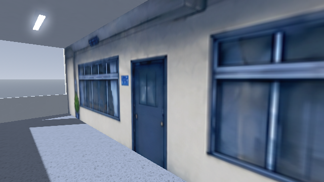
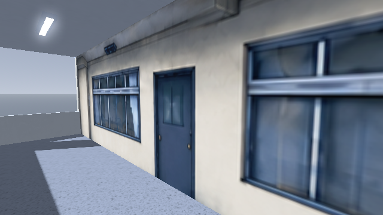
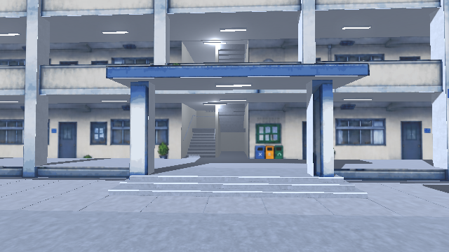
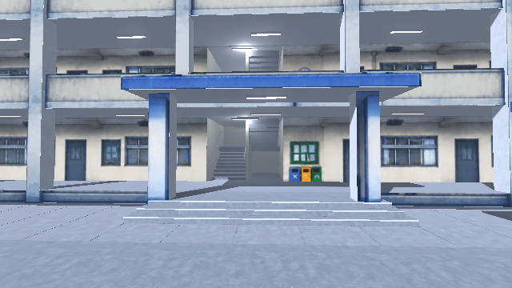
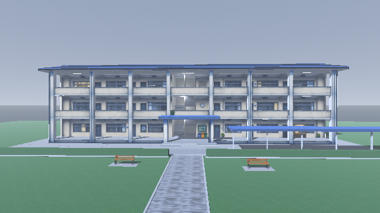
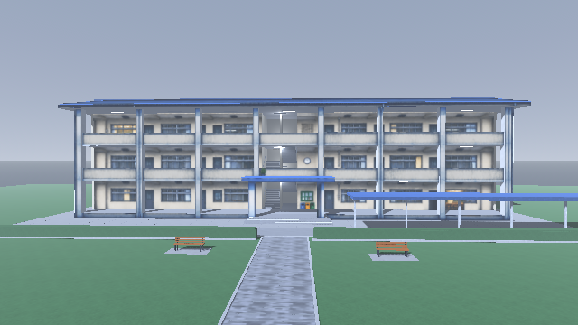

# Painted building clarity — PR12

Base: `ebacc6f25cc96422fc23398a504e54e93bfd2480`. Reviewed 2026-10-20.
Model blob: `e6c3fba00c2b141c747c57dc0d1b6cbf334f5012`. Wall image blob: `3ba1e3c400ebbcb42a2e32a23d59873eea666457`.

The painted classroom wall now uses `back_detail.png`, a restoration of the
existing repaired wall image with cleaner continuous door and window-frame
edges. Its native size is **2167 × 725**, the same as the repaired source.
The generation request asked for 3840 × 1280 but did not return that size;
this is not a 4K texture or recovery of lost original detail. Earlier wall art
is retained for reference. Built-in imagegen was used; the exact prompt is in
[clarity-prompt.txt](clarity-prompt.txt).

The canopy face and its front pillars now sample the author's original
1672 × 941 close-entrance image directly. This byte-identical copy is
`paint/entrance_detail.png`. The previous version shrank those pixels to
34.8% when composing the full-building atlas. Inverting that composition's
mapping provides about **2.87× the source texel density on these faces**,
without moving their meshes. The rest of the stair-hall wall stays on the
continuous repaired wall painting, avoiding a blue/cream join.

All painted materials now use anisotropic mipmap filtering, with lossless
imports and mipmaps. The game viewport remains 640 × 360 with nearest display
scaling. No sharpening shader or postprocessing pass is added. The building,
roof, grounds, lighting and cameras are retained from the current PR head,
including its removed planting cards and stair bench.

## Actual Godot captures

Same camera positions and lighting, native Godot 4.3 OpenGL Compatibility.

| View | Before | After |
| --- | --- | --- |
| Corridor wall |  |  |
| Entrance |  |  |
| Facade |  |  |

Inspected front, facade, entrance, oblique, corridor, courtyard outlook, roof
and close wall views on three floors plus stair hall. Improvement is moderate:
slender frames are more legible, the canopy retains more original image detail,
and there is no new join at the stair hall. Very close wall views remain soft
because an entire 40 m facade uses a finite-resolution painting. This revision
does not turn painted doors/windows into real openings or high-detail meshes.

Native 11-view rendering completed with no script/shader errors; only the
software driver's unsupported VSync warning. `git diff --check` passed.
Browser/mobile playback and GPU performance were not measured. Decision:
ready for review within this limited clarity scope, not merged or deployed.
