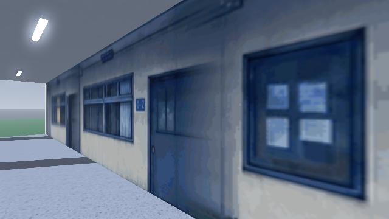
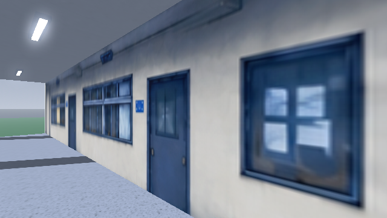
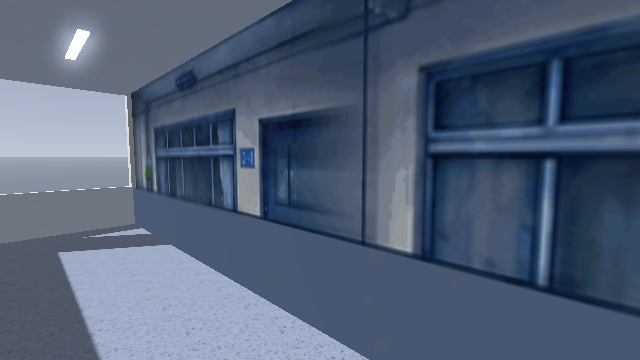

# Rear classroom wall repair

Base: `9f8126682c0f2072a080e5884b6bc0bedaef28c5` (PR12). Reviewed on 2026-10-19.
Model blob: `8a2133cb757a38e8df1d6bb098aade9e14416006`.
Repair image blob: `509598202557ae82e81d4ebc4fafabd19da211c7`.

## Problem and result

The old `paint/back.png` stretched adjacent colors into the areas hidden by foreground pillars. This left vertical smears on door edges. Grey filler bands behind the balcony parapets also cut off upper-floor doors and windows when viewed from inside the corridor.

The rear-wall material now uses `assets/bg/school/paint/back_repair.png`: a continuous repaired painting with complete doors, window frames, sills and lower plaster. The original `back.png` and original author images remain available. The original front/mid/props paintings, geometry, camera, lighting, actual columns, parapets and other scenes are unchanged by this follow-up.

The repaired atlas was made with the built-in image generation/editing tool from the existing wall image and building reference; [prompts](wall-repair-prompt.txt). The output is 2167 × 725 rather than the original 2168 × 725. Normalized texture UVs map it to the same building dimensions. It replaces the full rear-wall painting to avoid visible joins from mixing local patches with the old image. Its painted details are a reconstruction, not recovered hidden source pixels.

## Actual Godot 4.3 captures

Identical camera positions, lighting and 640 × 360 game viewport; native Compatibility renderer.

| View | Before | After |
| --- | --- | --- |
| Ground-floor former pillar strip |  |  |
| Second-floor doors/windows |  |  |

## Verification and limits

- Inspected close views on all three floors and beside the stair hall, plus the front, entrance, oblique view and corridor. The former vertical smears, grey horizontal bands and joins between patched window/door edges are absent in the final views.
- Godot import and the 11-view native capture run completed without script/shader errors. The software graphics driver reported its usual unsupported V-Sync warning.
- `git diff --check` passed. The existing material pipeline still uses one rear-wall material; no extra repair shader, draw layer or runtime patching system is needed.
- These are static native captures. Browser/mobile rendering and moving-camera playback were not validated in this follow-up. Existing simple side/back building surfaces remain outside this artwork repair.

Reproduce using `tests/school_front_review.gd` and the commands in the main review document. Decision: ready for review of the repaired rear-wall artwork; PR remains unmerged.
